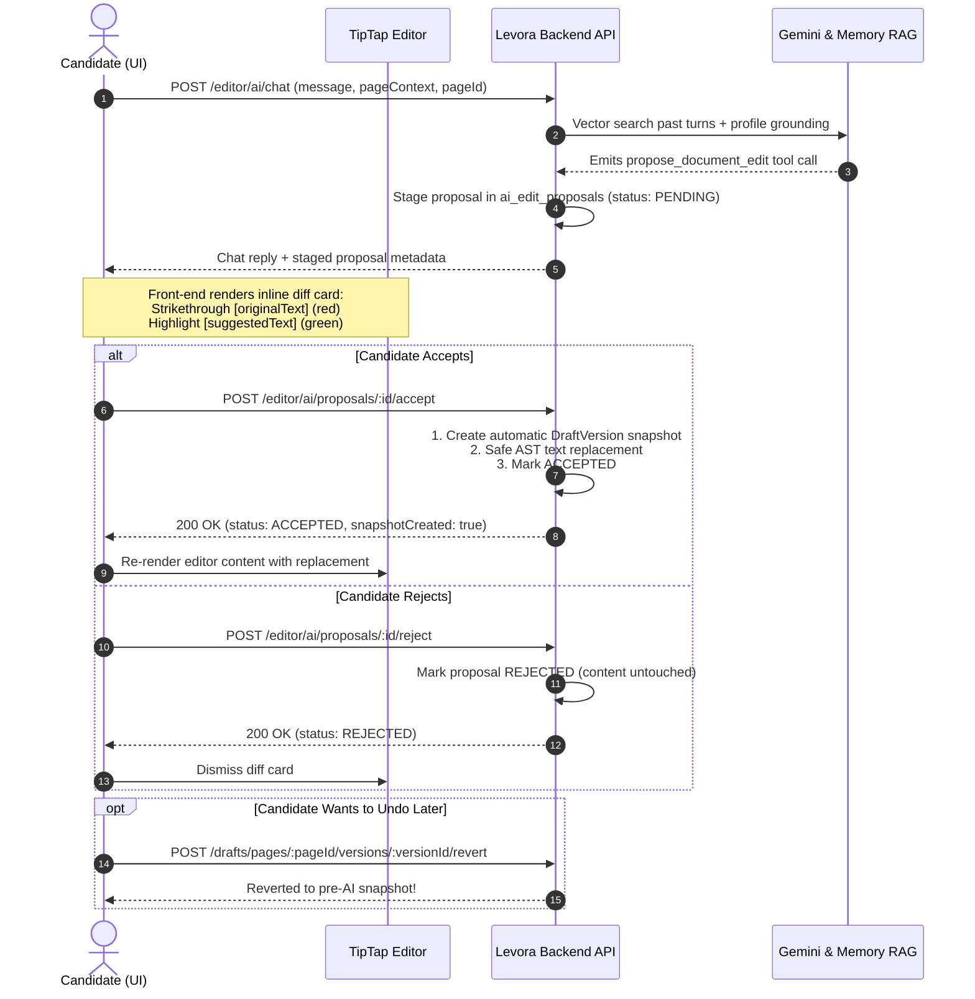

# Levora Front-End API Integration Guide: Features 10 & 11 (Complete & Exhaustive)

**Feature Name**: Personal Drafts, In-Editor AI Writing Assistant, Conversational Memory RAG & Staged Proposals  
**Target Audience**: Front-End Engineers, Mobile Engineers, QA Automation, and Technical Leads  
**Protocol**: RESTful over HTTPS (JSON / Multipart Form-Data)  
**Base Path**: `/api/v1`  
**Authentication**: Bearer Token (`Authorization: Bearer <accessToken>`)  
**Postman Suite**: `Levora_API.postman_collection.json`  

---

## Table of Contents
1. [Global Architectural Conventions & Envelopes](#1-global-architectural-conventions--envelopes)
2. [Draft Workspaces API (`/drafts/spaces`)](#2-draft-workspaces-api-draftsspaces)
3. [Draft Pages & REST Auto-Save API (`/drafts/spaces/:slug/pages`)](#3-draft-pages--rest-auto-save-api-draftsspacesslugpages)
4. [Version History & Rollback API (`/drafts/pages/:pageId/versions`)](#4-version-history--rollback-api-draftspagespageidversions)
5. [PDF Finalization & Profile Activation API (`/drafts/pages/:pageId`)](#5-pdf-finalization--profile-activation-api-draftspagespageid)
6. [Embedded Media & Attachments API (`/drafts/spaces/:slug/pages/:pageId/attachments`)](#6-embedded-media--attachments-api-draftsspacesslugpagespageidattachments)
7. [Workspace Tags API (`/drafts/spaces/:slug/tags`)](#7-workspace-tags-api-draftsspacesslugtags)
8. [Draft Templates API (`/drafts/templates`)](#8-draft-templates-api-draftstemplates)
9. [In-Editor AI Writing Assistant & Staged Proposals API (`/editor/ai`)](#9-in-editor-ai-writing-assistant--staged-proposals-api-editorai)
   - 9.1 [Transform Highlighted Text (`POST /editor/ai/edit`)](#91-transform-highlighted-text-post-editoraiedit)
   - 9.2 [Generate Starter Content (`POST /editor/ai/generate`)](#92-generate-starter-content-post-editoraigenerate)
   - 9.3 [Conversational Memory RAG Chat Copilot (`POST /editor/ai/chat`)](#93-conversational-memory-rag-chat-copilot-post-editoraichat)
   - 9.4 [List Staged Edit Proposals for Page (`GET /editor/ai/proposals/page/:pageId`)](#94-list-staged-edit-proposals-for-page-get-editoraiproposalspagepageid)
   - 9.5 [Accept Staged Edit Proposal (`POST /editor/ai/proposals/:proposalId/accept`)](#95-accept-staged-edit-proposal-post-editoraiproposalsproposalidaccept)
   - 9.6 [Reject Staged Edit Proposal (`POST /editor/ai/proposals/:proposalId/reject`)](#96-reject-staged-edit-proposal-post-editoraiproposalsproposalidreject)
   - 9.7 [Front-End Integration Recipe: Staged AI Proposals & AST Diff Review](#97-front-end-integration-recipe-staged-ai-proposals--ast-diff-review)
10. [Universal Notifications API (`/notifications`)](#10-universal-notifications-api-notifications)
11. [Controlled Onboarding via Invitations API (`/auth`)](#11-controlled-onboarding-via-invitations-api-auth)
12. [Complete HTTP Status & Error Code Matrix](#12-complete-http-status--error-code-matrix)
13. [Front-End Implementation Recipes & Best Practices](#13-front-end-implementation-recipes--best-practices)

---

## 1. Global Architectural Conventions & Envelopes

### 1.1 Request Headers
All authenticated endpoints require the following headers:
```http
Authorization: Bearer <accessToken>
Content-Type: application/json
Accept: application/json
X-Request-ID: <client-generated-uuid>
```
*Note: For multipart file uploads, omit `Content-Type: application/json` so the browser/client sets `multipart/form-data; boundary=...` automatically.*

### 1.2 Standard Success Response Envelope
All successful requests (`200 OK`, `201 Created`) are automatically wrapped by the backend `TransformInterceptor`:
```typescript
interface ApiResponse<T> {
  statusCode: number;    // HTTP status code (200, 201)
  message: string;       // Human-readable summary (e.g. "OK", "Created successfully")
  data: T;               // Response payload object or array
  meta?: {               // Metadata for pagination, request tracing, or deprecation
    pagination?: {
      total: number;     // Total records count across all pages
      page: number;      // Current active page number (1-based)
      limit: number;     // Items per page
      totalPages: number;// Calculated total pages
      hasNext: boolean;  // Boolean indicating if next page exists
      hasPrev: boolean;  // Boolean indicating if previous page exists
    };
    requestId?: string;  // Server or client request tracing ID
  };
  timestamp: string;     // ISO-8601 UTC timestamp
}
```

### 1.3 Standard Error Response Envelope
All error responses (`4xx`, `5xx`) are caught and formatted by `AllExceptionsFilter`:
```typescript
interface ApiErrorResponse {
  statusCode: number;    // e.g. 400, 401, 403, 404, 409, 422, 429, 500
  message: string;       // Primary error message
  data: null;
  errors: Array<{
    code: string;        // Machine-readable error code (e.g. "VALIDATION_REQUIRED")
    message: string;     // Contextual error detail
  }>;
  timestamp: string;     // ISO-8601 UTC timestamp
}
```

---

## 2. Draft Workspaces API (`/drafts/spaces`)

Workspaces provide isolated environments for organizing related documents (e.g., "Chevening 2026", "Oxford Master Application"). Workspaces are strictly scoped to the authenticated user (`@@unique([ownerId, slug])`).

### 2.1 List Workspaces
- **Endpoint**: `GET /api/v1/drafts/spaces`
- **Auth**: Bearer Token (Candidate or Admin)
- **Response**: `200 OK`
```json
{
  "statusCode": 200,
  "message": "OK",
  "data": [
    {
      "id": "e2f1b8a3-4b6c-482a-96e0-81d3f9bca101",
      "ownerId": "usr_99887766-5544-3322-1100-aabbccddeeff",
      "name": "Chevening Scholarship 2026",
      "slug": "chevening-scholarship-2026",
      "description": "Essays and statement of purpose for UK master's application",
      "icon": "graduation-cap",
      "createdAt": "2026-10-17T10:00:00.000Z",
      "updatedAt": "2026-10-17T11:00:00.000Z",
      "_count": {
        "pages": 4
      }
    }
  ],
  "timestamp": "2026-10-17T17:00:00.000Z"
}
```

### 2.2 Create Workspace
- **Endpoint**: `POST /api/v1/drafts/spaces`
- **Auth**: Bearer Token
- **Request Body**:
```json
{
  "name": "Erasmus Mundus 2026",
  "description": "Application package for Joint Master Degree",
  "icon": "book-open"
}
```
- **Validation**:
  - `name`: Required string, 1 to 255 characters.
  - `description`: Optional string.
  - `icon`: Optional string (Lucide icon identifier, max 100 chars).
- **Slug Generation**: The slug is auto-generated using `slugify(name, { lower: true, strict: true })`. If the user already owns a workspace with the same slug, the system automatically appends an incremental counter (e.g. `erasmus-mundus-2026-1`).
- **Response**: `201 Created` with the newly created Workspace object.

### 2.3 Get Workspace Details & Document Hierarchy Tree
- **Endpoint**: `GET /api/v1/drafts/spaces/:slug`
- **Auth**: Bearer Token (Owner only; unauthorized users receive `404 Not Found`)
- **Path Params**: `slug` (string) — Workspace slug identifier.
- **Response**: `200 OK` with nested document hierarchy:
```json
{
  "statusCode": 200,
  "message": "OK",
  "data": {
    "id": "e2f1b8a3-4b6c-482a-96e0-81d3f9bca101",
    "name": "Chevening Scholarship 2026",
    "slug": "chevening-scholarship-2026",
    "description": "Essays and statement of purpose",
    "icon": "graduation-cap",
    "pages": [
      {
        "id": "3c7b2e8d-8a4f-45b9-912a-718293abcdef",
        "title": "Leadership Essay",
        "slug": "leadership-essay",
        "status": "DRAFT",
        "position": 0,
        "parentId": null,
        "documentId": null,
        "createdAt": "2026-10-17T10:15:00.000Z",
        "updatedAt": "2026-10-17T10:45:00.000Z",
        "children": [
          {
            "id": "4d8c3f9e-9b5a-46ca-923b-8293a4bcdef0",
            "title": "Supporting Case Notes",
            "slug": "supporting-case-notes",
            "status": "DRAFT",
            "position": 0,
            "parentId": "3c7b2e8d-8a4f-45b9-912a-718293abcdef",
            "children": []
          }
        ]
      }
    ]
  },
  "timestamp": "2026-10-17T17:00:00.000Z"
}
```

### 2.4 Update Workspace
- **Endpoint**: `PATCH /api/v1/drafts/spaces/:slug`
- **Auth**: Bearer Token (Owner only)
- **Request Body**:
```json
{
  "name": "Chevening UK 2026 (Revised)",
  "description": "Updated application package",
  "icon": "folder-check"
}
```
- **Response**: `200 OK` with updated Workspace object.

### 2.5 Delete Workspace
- **Endpoint**: `DELETE /api/v1/drafts/spaces/:slug`
- **Auth**: Bearer Token (Owner only)
- **Response**: `200 OK` with `{ "message": "Workspace deleted successfully" }`.
- *Note: All contained pages, versions, attachments, and tags are cascade-deleted.*

---

## 3. Draft Pages & REST Auto-Save API (`/drafts/spaces/:slug/pages`)

Manages individual document pages within a workspace. Pages store their content as ProseMirror/TipTap AST JSON structures.

### 3.1 Create Page
- **Endpoint**: `POST /api/v1/drafts/spaces/:slug/pages`
- **Auth**: Bearer Token (Owner of workspace)
- **Request Body**:
```json
{
  "title": "Personal Statement",
  "parentId": "3c7b2e8d-8a4f-45b9-912a-718293abcdef",
  "documentId": "1a2b3c4d-5e6f-7a8b-9c0d-1e2f3a4b5c6d",
  "contentJson": {
    "type": "doc",
    "content": [
      {
        "type": "paragraph",
        "content": [{ "type": "text", "text": "I am applying for..." }]
      }
    ]
  }
}
```
- **Fields**:
  - `title`: Required string (max 500 characters).
  - `parentId`: Optional UUID of a parent page to create nested sub-pages.
  - `documentId`: Optional UUID of an existing base document to establish lineage.
  - `contentJson`: Optional initial ProseMirror/TipTap AST object.
- **Response**: `201 Created` with full draft page record.

### 3.2 Get Page Details
- **Endpoint**: `GET /api/v1/drafts/spaces/:slug/pages/:pageId`
- **Auth**: Bearer Token (Owner only)
- **Path Params**:
  - `slug`: Workspace slug.
  - `pageId`: Draft page UUID.
- **Response**: `200 OK`
```json
{
  "statusCode": 200,
  "message": "OK",
  "data": {
    "id": "3c7b2e8d-8a4f-45b9-912a-718293abcdef",
    "spaceId": "e2f1b8a3-4b6c-482a-96e0-81d3f9bca101",
    "title": "Personal Statement",
    "slug": "personal-statement",
    "contentJson": {
      "type": "doc",
      "content": [
        {
          "type": "heading",
          "attrs": { "level": 1 },
          "content": [{ "type": "text", "text": "Academic Background" }]
        },
        {
          "type": "paragraph",
          "content": [{ "type": "text", "text": "My research in computer vision..." }]
        }
      ]
    },
    "plainText": "Academic Background\n\nMy research in computer vision...",
    "excerpt": "My research in computer vision...",
    "wordCount": 142,
    "readingTime": 1,
    "status": "DRAFT",
    "position": 0,
    "parentId": null,
    "documentId": null,
    "createdAt": "2026-10-17T11:00:00.000Z",
    "updatedAt": "2026-10-17T11:20:00.000Z",
    "tags": [
      {
        "tag": {
          "id": "7a8b9c0d-1e2f-3a4b-5c6d-7e8f9a0b1c2d",
          "name": "Scholarship",
          "color": "#3B82F6"
        }
      }
    ],
    "attachments": []
  },
  "timestamp": "2026-10-17T17:00:00.000Z"
}
```

### 3.3 Auto-Save Page (`PATCH`)
- **Endpoint**: `PATCH /api/v1/drafts/spaces/:slug/pages/:pageId`
- **Auth**: Bearer Token (Owner only)
- **Recommended Call Frequency**: Debounce by 1,500ms after user stops typing.
- **Request Body**:
```json
{
  "title": "Personal Statement - Final Draft",
  "contentJson": {
    "type": "doc",
    "content": [
      {
        "type": "heading",
        "attrs": { "level": 1 },
        "content": [{ "type": "text", "text": "Leadership & Community Impact" }]
      },
      {
        "type": "paragraph",
        "content": [{ "type": "text", "text": "Over the past three years..." }]
      }
    ]
  },
  "status": "IN_PROGRESS",
  "position": 0,
  "parentId": null
}
```
<!-- [OMA-W003-T002] Align status enum with schema and spec -->
- **Lifecycle Status Enum**: `DRAFT`, `IN_PROGRESS`, `FINALIZED`, `ARCHIVED`.
- **Automatic Calculations**:
  - The backend extracts `plainText` from the AST nodes.
  - Generates a concise `excerpt` (first 250 characters).
  - Computes `wordCount` and `readingTime` (assuming 200 words/min).
  - If `title` changed, re-generates unique `slug`.
- **Special Status Code (409 Conflict)**:
  - If the page is currently in `FINALIZED` status, this endpoint returns `409 Conflict`:
  ```json
  {
    "statusCode": 409,
    "message": "Draft is locked in FINALIZED state. Unlock the page to create a new revision.",
    "data": null,
    "errors": [
      {
        "code": "DRAFT_PAGE_FINALIZED_LOCK",
        "message": "Draft is locked in FINALIZED state. Unlock the page to create a new revision."
      }
    ],
    "timestamp": "2026-10-17T17:00:00.000Z"
  }
  ```
- **Response**: `200 OK` with updated page object.

### 3.4 Soft-Delete Page
- **Endpoint**: `DELETE /api/v1/drafts/spaces/:slug/pages/:pageId`
- **Auth**: Bearer Token (Owner only)
- **Response**: `200 OK` with `{ "message": "Draft page moved to trash" }`.

---

## 4. Version History & Rollback API (`/drafts/pages/:pageId/versions`)

Enables candidates to review changes over time and safely revert to earlier snapshots.

### 4.1 List Version Snapshots
- **Endpoint**: `GET /api/v1/drafts/pages/:pageId/versions`
- **Auth**: Bearer Token (Owner of page)
- **Response**: `200 OK` with chronological version array:
```json
{
  "statusCode": 200,
  "message": "OK",
  "data": [
    {
      "id": "9f8e7d6c-5b4a-3928-1701-a1b2c3d4e5f6",
      "pageId": "3c7b2e8d-8a4f-45b9-912a-718293abcdef",
      "versionNumber": 3,
      "title": "Personal Statement",
      "versionName": "Pre-Finalization Snapshot",
      "plainText": "Leadership & Community Impact\n\nOver the past three years...",
      "wordCount": 750,
      "createdAt": "2026-10-17T11:45:00.000Z"
    },
    {
      "id": "8e7d6c5b-4a39-2817-01a2-b3c4d5e6f7a8",
      "pageId": "3c7b2e8d-8a4f-45b9-912a-718293abcdef",
      "versionNumber": 2,
      "title": "Personal Statement",
      "versionName": "Draft with Academic Polish",
      "plainText": "Early draft content...",
      "wordCount": 540,
      "createdAt": "2026-10-17T11:15:00.000Z"
    }
  ],
  "timestamp": "2026-10-17T17:00:00.000Z"
}
```

### 4.2 Revert to a Historical Version
- **Endpoint**: `POST /api/v1/drafts/pages/:pageId/versions/:versionId/revert`
- **Auth**: Bearer Token (Owner only)
- **Behavior**:
  1. Creates an automatic backup snapshot of the current active page state before performing rollback.
  2. Overwrites `contentJson`, `plainText`, `wordCount`, and `title` with the historical snapshot.
  3. Increments the version counter.
- **Response**: `200 OK` with the restored page object.

---

## 5. PDF Finalization & Profile Activation API (`/drafts/pages/:pageId`)

The pipeline that transforms a draft into an official application PDF and makes it the active profile document.

### 5.1 Finalize Draft (`POST /finalize`)
- **Endpoint**: `POST /api/v1/drafts/pages/:pageId/finalize`
- **Auth**: Bearer Token (Owner of page)
- **Request Body**:
```json
{
  "documentTypeId": "5d47cc7c-5264-4bfb-94d2-fdafa83e6b70",
  "displayName": "Chevening_Statement_Fatima.pdf"
}
```
- **Fields**:
  - `documentTypeId`: Optional UUID of target document type (e.g. CV, Personal Statement). If omitted, falls back to the system's default document type.
  - `displayName`: Optional custom filename (max 255 chars).
- **Execution Flow**:
  1. *Zero-Browser Pure Node.js Compilation*: TipTap/ProseMirror JSON AST is parsed in-process using `pdfmake` with Standard 14 PDF typography (Helvetica, Times, Courier), 20mm margins, running title header, and dynamic footer (`Page X of Y`). Zero external browser binaries or sandbox overhead.
  2. *Cloud/Local Storage Upload*: Compiled PDF buffer is uploaded via `StorageService` to `documents/${userId}/...`.
  3. *Immutable Record Creation*: An official row is created in the core PostgreSQL `documents` table, linked to the specified `documentTypeId`.
  4. *Profile Activation*: The newly generated document is activated in the candidate's profile document collection.
  5. *State Locking*: The draft page's `document_id` is linked and its status is locked to `FINALIZED`.
  6. *One-Roundtrip Composite DTO*: Returns presigned `downloadUrl` and `status` immediately so the front-end can display or download the generated PDF without making a second roundtrip.
- **Response**: `201 Created`
```json
{
  "statusCode": 201,
  "message": "Created successfully",
  "data": {
    "documentId": "e359a576-1039-4cd8-9108-278a11d45f6d",
    "pageId": "fc2d06dd-a2d7-458c-99c0-4cc7ffbdeb90",
    "status": "FINALIZED",
    "pdfUrl": "https://s3.eu-west-1.amazonaws.com/levora-documents/finalized/...?token=...",
    "downloadUrl": "https://s3.eu-west-1.amazonaws.com/levora-documents/finalized/...?token=...",
    "message": "Draft compiled into PDF, stored in documents, and activated in candidate profile."
  },
  "meta": {
    "requestId": "8645829f-76cb-427c-a735-22ff133abef8"
  },
  "timestamp": "2026-10-19T06:09:03.000Z"
}
```

### 5.2 Unlock Draft (`POST /unlock`)
- **Endpoint**: `POST /api/v1/drafts/pages/:pageId/unlock`
- **Auth**: Bearer Token (Owner only)
- **Behavior**: Transitions the page status from `FINALIZED` back to `IN_PROGRESS`. This removes the editing lock while preserving the previously finalized PDF in the candidate's documents repository.
- **Response**: `200 OK`
```json
{
  "statusCode": 200,
  "message": "OK",
  "data": {
    "unlocked": true,
    "status": "IN_PROGRESS"
  },
  "meta": {
    "requestId": "1b2d4f40-1f24-411d-a56c-fc3c4a0240dd"
  },
  "timestamp": "2026-10-19T06:09:05.000Z"
}
```

---

## 6. Embedded Media & Attachments API (`/drafts/spaces/:slug/pages/:pageId/attachments`)

Uploads figures, charts, and reference PDFs to be embedded into drafts.

### 6.1 Upload Media Attachment
- **Endpoint**: `POST /api/v1/drafts/spaces/:slug/pages/:pageId/attachments`
- **Auth**: Bearer Token (Owner only)
- **Content-Type**: `multipart/form-data`
- **Form Body**: Field named `file` (Binary).
- **Guards & Limits**:
  - Max Size: **10 MB** (enforced by `MaxFileSizeValidator`).
  - Allowed MIME Types: `application/pdf`, `image/jpeg`, `image/png`, `image/webp`, `image/gif`, `image/svg+xml`, `text/markdown`, `text/plain`, `application/msword`, `application/vnd.openxmlformats-officedocument.wordprocessingml.document`.
- **Response**: `201 Created`
```json
{
  "statusCode": 201,
  "message": "Created successfully",
  "data": {
    "id": "5a6b7c8d-9e0f-1a2b-3c4d-5e6f7a8b9c0d",
    <!-- [OMA-W004-T004] Align attachment response fields with database schema -->
    "filename": "experimental_chart.png",
    "sizeBytes": 245800,
    "mimeType": "image/png",
    "url": "https://s3.eu-west-1.amazonaws.com/attachments/5a6b7c8d.png",
    "createdAt": "2026-10-17T11:20:00.000Z"
  },
  "timestamp": "2026-10-17T17:00:00.000Z"
}
```

### 6.2 Get Signed Download URL
- **Endpoint**: `GET /api/v1/drafts/spaces/:slug/pages/:pageId/attachments/:attachmentId/download`
- **Auth**: Bearer Token (Owner only)
- **Response**: `200 OK`
```json
{
  "statusCode": 200,
  "message": "OK",
  <!-- [OMA-W004-T004] Standardize downloadUrl response -->
  "data": {
    "downloadUrl": "https://s3.eu-west-1.amazonaws.com/attachments/...?X-Amz-Signature=...",
    "filename": "experimental_chart.png"
  },
  "timestamp": "2026-10-17T17:00:00.000Z"
}
```

### 6.3 Delete Attachment
- **Endpoint**: `DELETE /api/v1/drafts/spaces/:slug/pages/:pageId/attachments/:attachmentId`
- **Auth**: Bearer Token (Owner only)
- **Response**: `200 OK` with `{ "message": "Attachment deleted successfully" }`.

---

## 7. Workspace Tags API (`/drafts/spaces/:slug/tags`)

Organizes draft pages using color-coded tags.

### 7.1 List Tags in Workspace
- **Endpoint**: `GET /api/v1/drafts/spaces/:slug/tags`
- **Auth**: Bearer Token (Owner only)
- **Response**: `200 OK`
```json
{
  "statusCode": 200,
  "message": "OK",
  "data": [
    {
      "id": "7a8b9c0d-1e2f-3a4b-5c6d-7e8f9a0b1c2d",
      "name": "Scholarship",
      "color": "#3B82F6",
      "_count": {
        "pages": 3
      }
    },
    {
      "id": "8b9c0d1e-2f3a-4b5c-6d7e-8f9a0b1c2d3e",
      "name": "Research Proposal",
      "color": "#10B981",
      "_count": {
        "pages": 1
      }
    }
  ],
  "timestamp": "2026-10-17T17:00:00.000Z"
}
```

### 7.2 Create Tag
- **Endpoint**: `POST /api/v1/drafts/spaces/:slug/tags`
- **Auth**: Bearer Token (Owner only)
- **Request Body**:
```json
{
  "name": "Urgent Revision",
  "color": "#EF4444"
}
```
- **Validation**:
  - `name`: Required string (max 50 chars). Unique per workspace.
  - `color`: Optional hex code string (e.g. `#10B981`).
- **Response**: `201 Created` with created Tag object.

### 7.3 Assign Tag to Page
- **Endpoint**: `POST /api/v1/drafts/spaces/:slug/tags/:tagId/pages/:pageId`
- **Auth**: Bearer Token (Owner only)
- **Response**: `200 OK` with `{ "message": "Tag assigned to page successfully" }`.

### 7.4 Remove Tag from Page
- **Endpoint**: `DELETE /api/v1/drafts/spaces/:slug/tags/:tagId/pages/:pageId`
- **Auth**: Bearer Token (Owner only)
- **Response**: `200 OK` with `{ "message": "Tag removed from page successfully" }`.

### 7.5 Delete Tag
- **Endpoint**: `DELETE /api/v1/drafts/spaces/:slug/tags/:tagId`
- **Auth**: Bearer Token (Owner only)
- **Response**: `200 OK` with `{ "message": "Tag deleted successfully" }`.

---

## 8. Draft Templates API (`/drafts/templates`)

Templates allow starting new drafts with pre-configured layouts and boilerplate text.

### 8.1 List Available Templates
- **Endpoint**: `GET /api/v1/drafts/templates`
- **Auth**: Bearer Token
- **Query Params**:
  - `category`: Optional string filter (`scholarship`, `admission`, `cover_letter`, `general`).
- **Response**: `200 OK` (returns global system templates and user's private templates):
```json
{
  "statusCode": 200,
  "message": "OK",
  "data": [
    {
      "id": "11223344-5566-7788-9900-aabbccddeeff",
      "title": "Chevening Leadership Essay Template",
      "description": "Standard 4-paragraph STAR layout for leadership essays",
      "category": "scholarship",
      "isDefault": true,
      "createdById": null,
      "createdAt": "2026-10-17T08:00:00.000Z"
    },
    {
      "id": "22334455-6677-8899-0011-bbccddeeff00",
      "title": "My Custom Research Statement",
      "description": "Personal 3-part layout",
      "category": "admission",
      "isDefault": false,
      "createdById": "usr_99887766-5544-3322-1100-aabbccddeeff",
      "createdAt": "2026-10-17T09:30:00.000Z"
    }
  ],
  "timestamp": "2026-10-17T17:00:00.000Z"
}
```

### 8.2 Get Template Details
- **Endpoint**: `GET /api/v1/drafts/templates/:id`
- **Auth**: Bearer Token
- **IDOR Protection**: Returns `200 OK` only if `isDefault === true` OR `createdById === req.user.id`. Otherwise returns `404 Not Found`.
- **Response**: `200 OK` with `contentJson` AST template:
```json
{
  "statusCode": 200,
  "message": "OK",
  "data": {
    "id": "11223344-5566-7788-9900-aabbccddeeff",
    "title": "Chevening Leadership Essay Template",
    "description": "Standard 4-paragraph STAR layout",
    "category": "scholarship",
    "isDefault": true,
    "contentJson": {
      "type": "doc",
      "content": [
        {
          "type": "heading",
          "attrs": { "level": 1 },
          "content": [{ "type": "text", "text": "Leadership & Influence" }]
        },
        {
          "type": "paragraph",
          "content": [{ "type": "text", "text": "[Situation: Describe the context...]" }]
        }
      ]
    }
  },
  "timestamp": "2026-10-17T17:00:00.000Z"
}
```

### 8.3 Create Custom Template
- **Endpoint**: `POST /api/v1/drafts/templates`
- **Auth**: Bearer Token
- **Request Body**:
```json
{
  "title": "Standard Motivation Letter",
  "description": "3-section structure for European masters applications",
  "category": "admission",
  "workspaceId": "e2f1b8a3-4b6c-482a-96e0-81d3f9bca101",
  "contentJson": {
    "type": "doc",
    "content": [
      {
        "type": "paragraph",
        "content": [{ "type": "text", "text": "Dear Selection Committee," }]
      }
    ]
  }
}
```
- **Privilege Rule**: Only administrators (`system_admin`, `admin`) can publish templates with `isDefault: true`. Candidate submissions with `isDefault: true` are automatically forced to `isDefault: false`.
- **Response**: `201 Created` with created Template object.

### 8.4 Delete Custom Template
- **Endpoint**: `DELETE /api/v1/drafts/templates/:id`
- **Auth**: Bearer Token (Creator or Admin only)
- **Response**: `200 OK` with `{ "message": "Template deleted successfully" }`.

---

## 9. In-Editor AI Writing Assistant API (`/editor/ai`)

Provides AI transformations, starter text generation, and interactive chat copilot powered by OpenAI and Anthropic models.

### 9.1 Transform Highlighted Text (`POST /editor/ai/edit`)
- **Endpoint**: `POST /api/v1/editor/ai/edit`
- **Auth**: Bearer Token
- **Request Body**:
```json
{
  "text": "I really want to get into your university because it is very good and famous.",
  "mode": "academic_tone",
  "instructions": "Make it sound persuasive and grounded in research excellence"
}
```
- **Allowed `mode` Enum Values**:
  - `academic_tone`: Converts colloquial language into formal, rigorous scholarship tone.
  - `rephrase`: Smooth paraphrasing to enhance flow and sentence variety.
  - `grammar`: Corrects grammar, spelling, punctuation, and syntax errors.
  - `shorten`: Condenses wordy paragraphs to meet strict character or word counts.
  - `expand`: Elaborates on key concepts with deeper academic context.
  - `summarize`: Generates a concise summary.
- **Input Guardrails**: `text` and `instructions` are capped at 50,000 characters.
- **Response**: `200 OK`
```json
{
  "statusCode": 200,
  "message": "OK",
  "data": {
    "originalText": "I really want to get into your university...",
    "transformedText": "I am eager to pursue postgraduate studies at your institution, drawn by its distinguished record in cutting-edge research...",
    "mode": "academic_tone"
  },
  "timestamp": "2026-10-17T17:00:00.000Z"
}
```

### 9.2 Generate Starter Content (`POST /editor/ai/generate`)
- **Endpoint**: `POST /api/v1/editor/ai/generate`
- **Auth**: Bearer Token
- **Request Body**:
```json
{
  "prompt": "Draft an outline for a 500-word Chevening leadership essay.",
  "context": "Candidate has 3 years of experience leading an environmental NGO in Amman."
}
```
- **Input Guardrails**: `prompt` and `context` are capped at 50,000 characters.
- **Response**: `200 OK`
```json
{
  "statusCode": 200,
  "message": "OK",
  "data": {
    "content": "### 1. Introduction: The Catalyst for Environmental Action\n- Contextualize the NGO mission in Amman...\n\n### 2. The Core Leadership Challenge...",
    "format": "markdown"
  },
  "timestamp": "2026-10-17T17:00:00.000Z"
}
```

### 9.3 Conversational Memory RAG Chat Copilot (`POST /editor/ai/chat`)
- **Endpoint**: `POST /api/v1/editor/ai/chat`
- **Auth**: Bearer Token
- **Purpose**: Interactive AI writing partner that remembers previous conversation context across turns using in-process semantic vector embeddings (`all-MiniLM-L6-v2`, 384 dimensions) and PostgreSQL `pgvector` HNSW cosine distance search. Also grounds suggestions in the candidate's verified profile (degree, major, GPA, skills, languages) and can stage concrete document edits via function tool-calling.
- **Request Body**:
```json
{
  "message": "Can you review the opening of my leadership essay and suggest improvements?",
  "conversationId": "33a38bb6-b264-40b5-9bc1-c7fad529bf35",
  "pageId": "fc2d06dd-a2d7-458c-99c0-4cc7ffbdeb90",
  "pageContext": "I really want to get into your university because it is very good and famous."
}
```
- **Fields**:
  - `message` (string, required): The candidate's query or instruction (max 50,000 characters).
  - `conversationId` (UUID string, optional): Thread identifier. If omitted or null, a new conversation thread is initialized and returned. Pass this ID in subsequent turns to maintain memory.
  - `pageId` (UUID string, optional): UUID of the active draft page. Required if you want the assistant to be able to propose staged text edits.
  - `pageContext` (string, optional): Excerpt or full text of the active draft page to give the AI immediate situational context.
- **Under the Hood (Conversational Memory RAG Architecture)**:
  1. *Profile Grounding*: Automatically fetches the authenticated candidate's degree, major, GPA, languages, and skills from `user_profiles` to tailor responses without hallucinations.
  2. *Vector Retrieval*: Searches past conversation turns using cosine similarity over Supabase `ai_message_embeddings` (HNSW index), retrieving top-5 relevant turns while excluding the 3 most recent turns to avoid prompt redundancy.
  3. *Dynamic Model Resolution*: Powered by Google Generative AI (`gemini-3.5-flash-lite` by default, configurable via `.env`).
  4. *Asynchronous Background Indexing*: Every user and assistant message turn is asynchronously embedded in the background ($0.00 external cost via local ONNX runtime) without blocking the HTTP response.
- **Response**: `200 OK`
```json
{
  "statusCode": 200,
  "message": "OK",
  "data": {
    "conversationId": "33a38bb6-b264-40b5-9bc1-c7fad529bf35",
    "reply": "The current opening is a bit too brief and colloquial. To capture the admissions committee's attention, consider grounding your opening in a defining leadership challenge you navigated in Amman.\n\nI have generated a formal revision proposal for this paragraph that you can review and apply directly.",
    "model": "gemini-3.5-flash-lite"
  },
  "meta": {
    "requestId": "3ec5eda2-fd7c-4391-92db-f01b8f3c439a"
  },
  "timestamp": "2026-10-19T06:03:42+00:00"
}
```

---

### 9.4 List Staged Edit Proposals for Page (`GET /editor/ai/proposals/page/:pageId`)
- **Endpoint**: `GET /api/v1/editor/ai/proposals/page/:pageId`
- **Auth**: Bearer Token
- **Purpose**: Retrieves all staged edit proposals generated by the AI assistant for the specified draft page. The front-end uses this list to render pending inline suggestion diffs or sidebar review cards.
- **Path Params**:
  - `pageId` (UUID): Draft page UUID.
- **Tenant Isolation**: Only returns proposals belonging to the authenticated candidate for the specified page (`where: { pageId, userId }`).
- **Response**: `200 OK`
```json
{
  "statusCode": 200,
  "message": "OK",
  "data": [
    {
      "id": "8b9404f4-9c94-4685-b04d-989987679969",
      "pageId": "fc2d06dd-a2d7-458c-99c0-4cc7ffbdeb90",
      "conversationId": "97a82549-0bb5-4aaa-80be-62ad06f9ebad",
      "userId": "8d25299d-31c1-44b1-940b-f446c7956b53",
      "originalText": "I really want to get into your university because it is very good and famous.",
      "suggestedText": "I am committed to pursuing graduate studies at your distinguished institution, motivated by its internationally acclaimed faculty and research excellence.",
      "explanation": "Elevates casual opening to a rigorous, scholarly tone.",
      "status": "PENDING",
      "appliedAt": null,
      "createdAt": "2026-10-19T06:03:54.344Z"
    }
  ],
  "meta": {
    "requestId": "9a3e39dd-26e6-43ea-9ee5-29bda78baad0"
  },
  "timestamp": "2026-10-19T06:03:57+00:00"
}
```
- **Proposal Status Lifecycle**:
  - `PENDING`: Staged and awaiting user action. Rendered with diff highlights.
  - `ACCEPTED`: User accepted the change. Applied to the draft page AST.
  - `REJECTED`: User discarded the change. Draft page content was untouched.

---

### 9.5 Accept Staged Edit Proposal (`POST /editor/ai/proposals/:proposalId/accept`)
- **Endpoint**: `POST /api/v1/editor/ai/proposals/:proposalId/accept`
- **Auth**: Bearer Token
- **Purpose**: Atomically accepts an AI edit proposal, executes an automatic rollback snapshot, safely replaces the target text in the ProseMirror/TipTap JSON AST, and marks the proposal `ACCEPTED`.
- **Path Params**:
  - `proposalId` (UUID): ID of the staged proposal.
- **Guarantees & Atomic Workflow**:
  1. *Atomic Status Check*: Uses `updateMany({ where: { id: proposalId, userId, status: 'PENDING' } })`. If `count === 0`, returns `409 Conflict`, preventing double-acceptance or race conditions.
  2. *Automatic Pre-Change Snapshot*: Calls `DraftVersionsService.createSnapshot()` to store a complete snapshot of the page's `contentJson` before applying edits. This guarantees the candidate can always roll back with one click if they dislike the result.
  3. *AST-Safe ProseMirror Replacement*: Recursively traverses the TipTap document node tree, locating text nodes where `node.text` contains `originalText` and safely replacing it with `suggestedText` without corrupting JSON structures, attributes, or marks.
  4. *Atomic Transaction*: The snapshot creation, draft page mutation, and proposal status update are executed together inside a single PostgreSQL transaction (`prisma.$transaction`).
- **Response**: `200 OK`
```json
{
  "statusCode": 200,
  "message": "OK",
  "data": {
    "proposalId": "8b9404f4-9c94-4685-b04d-989987679969",
    "status": "ACCEPTED",
    "snapshotCreated": true,
    "pageId": "fc2d06dd-a2d7-458c-99c0-4cc7ffbdeb90"
  },
  "meta": {
    "requestId": "f7f68d51-afee-4b4c-9868-3745485d9382"
  },
  "timestamp": "2026-10-19T06:04:01+00:00"
}
```
- **Error Cases**:
  - `404 Not Found`: Proposal does not exist.
  - `409 Conflict`: Proposal is already accepted, already rejected, or another client modified it concurrently (`SYSTEM_REQUEST_IN_PROGRESS`).

---

### 9.6 Reject Staged Edit Proposal (`POST /editor/ai/proposals/:proposalId/reject`)
- **Endpoint**: `POST /api/v1/editor/ai/proposals/:proposalId/reject`
- **Auth**: Bearer Token
- **Purpose**: Atomically marks a staged proposal as `REJECTED`. The draft document page remains completely untouched.
- **Path Params**:
  - `proposalId` (UUID): ID of the staged proposal.
- **Response**: `200 OK`
```json
{
  "statusCode": 200,
  "message": "OK",
  "data": {
    "proposalId": "ad6fda53-6453-410e-a24a-9281fb9cd4d3",
    "status": "REJECTED"
  },
  "meta": {
    "requestId": "1f9c957b-0788-4d8d-9d1a-c854a9bb3e9d"
  },
  "timestamp": "2026-10-19T06:04:13+00:00"
}
```

---

### 9.7 Front-End Integration Recipe: Staged AI Proposals & AST Diff Review

To give candidates a seamless, Google Docs-style "Suggested Edit" experience:



#### Recommended Front-End State Machine:
1. **Poll or Fetch on Load**: When opening a draft page, call `GET /editor/ai/proposals/page/:pageId` to display any unaddressed proposals.
2. **Inline Decoration**: In TipTap, use a Decoration or Extension to match `originalText` in the document and apply a subtle suggestion pill overlay showing `explanation`, a green checkmark button (Accept), and a red X button (Reject).
3. **Double-Click / Rapid-Click Guard**: Disable the Accept/Reject buttons immediately on click. If a `409 Conflict` is returned, show a toast notification: `"This suggestion has already been reviewed."` and refresh the proposal list.
4. **Instant Editor Sync**: Upon receiving `{ status: "ACCEPTED" }`, the frontend can either fetch the updated page via `GET /drafts/spaces/:slug/pages/:pageId` or immediately apply the string replacement in the local TipTap transaction.

---

## 10. Universal Notifications API (`/notifications`)

Integrated with native PostgreSQL `notifications` and `notification_types` tables.

### 10.1 Get Candidate Notifications
- **Endpoint**: `GET /api/v1/notifications`
- **Auth**: Bearer Token
- **Query Parameters**:
  - `page`: number (default: `1`, minimum: `1`)
  - `limit`: number (default: `20`, maximum: `100`)
  - `unreadOnly`: boolean (`true` | `false`, default: `false`)
- **Response**: `200 OK`
```json
{
  "statusCode": 200,
  "message": "OK",
  "data": [
    {
      "id": "1a2b3c4d-5e6f-7a8b-9c0d-e1f2a3b4c5d6",
      "type": {
        "code": "DOCUMENT_FINALIZED",
        "name": "Document Finalized",
        "icon": "file-check"
      },
      "title": "Document Finalized",
      "message": "Your draft 'Personal Statement' has been compiled to PDF and added to your profile.",
      "isRead": false,
      "metadata": {
        "pageId": "3c7b2e8d-8a4f-45b9-912a-718293abcdef",
        "documentId": "b1c2d3e4-f5a6-7b8c-9d0e-1f2a3b4c5d6e"
      },
      "createdAt": "2026-10-17T11:45:00.000Z"
    }
  ],
  "meta": {
    "pagination": {
      "total": 14,
      "page": 1,
      "limit": 20,
      "totalPages": 1,
      "hasNext": false,
      "hasPrev": false
    }
  },
  "timestamp": "2026-10-17T17:00:00.000Z"
}
```

### 10.2 Get Unread Badge Counter
- **Endpoint**: `GET /api/v1/notifications/unread-count`
- **Auth**: Bearer Token
- **Response**: `200 OK`
```json
{
  "statusCode": 200,
  "message": "OK",
  "data": {
    "unreadCount": 3
  },
  "timestamp": "2026-10-17T17:00:00.000Z"
}
```

### 10.3 Mark Single Notification as Read
- **Endpoint**: `PATCH /api/v1/notifications/:id/read`
- **Auth**: Bearer Token (Recipient only)
- **Path Params**: `id` (UUID) — Notification ID.
- **Response**: `200 OK`
```json
{
  "statusCode": 200,
  "message": "Updated successfully",
  "data": {
    "id": "1a2b3c4d-5e6f-7a8b-9c0d-e1f2a3b4c5d6",
    "isRead": true,
    "readAt": "2026-10-17T17:05:00.000Z"
  },
  "timestamp": "2026-10-17T17:05:00.000Z"
}
```

### 10.4 Mark All Notifications as Read
- **Endpoint**: `PATCH /api/v1/notifications/read-all`
- **Auth**: Bearer Token
- **Response**: `200 OK`
```json
{
  "statusCode": 200,
  "message": "All notifications marked as read",
  "data": {
    "count": 3
  },
  "timestamp": "2026-10-17T17:05:00.000Z"
}
```

---

## 11. Controlled Onboarding via Invitations API (`/auth`)

Governs candidate registration when public registration is disabled or restricted to certain email domains.

### 11.1 Issue Invitation (Admin Only)
- **Endpoint**: `POST /api/v1/auth/invitations`
- **Auth**: Bearer Token (Protected by `@Roles('system_admin', 'admin')`)
- **Request Body**:
```json
{
  "email": "candidate@oxford.ac.uk",
  "roleId": 1,
  "expiresInDays": 7
}
```
- **Validation**:
  - `email`: Required valid email address.
  - `roleId`: Optional integer role ID (1 = Candidate, 2 = Content Admin).
  - `expiresInDays`: Optional integer (1 to 30 days, default: 7).
- **Security**: The raw invite token is generated via `crypto.randomBytes(32)` and hashed using `SHA-256` before storage. The raw token is returned once in the invite link.
- **Response**: `201 Created`
```json
{
  "statusCode": 201,
  "message": "Created successfully",
  "data": {
    "invitationId": "f1e2d3c4-b5a6-7890-1234-56789abcdef0",
    "email": "candidate@oxford.ac.uk",
    "inviteLink": "https://app.levora.ai/register?inviteToken=4f9b8c2d1e0a9876543210fedcba...",
    "expiresAt": "2026-10-24T12:00:00.000Z"
  },
  "timestamp": "2026-10-17T17:00:00.000Z"
}
```

### 11.2 Validate Invitation Token (Public)
- **Endpoint**: `GET /api/v1/auth/invitations/:token`
- **Auth**: Public (`@Public()`)
- **Usage**: Call on the front-end sign-up page when an `inviteToken` query parameter is detected.
- **Success Response (200 OK)**:
```json
{
  "statusCode": 200,
  "message": "OK",
  "data": {
    "email": "candidate@oxford.ac.uk",
    "expiresAt": "2026-10-24T12:00:00.000Z",
    "isValid": true
  },
  "timestamp": "2026-10-17T17:00:00.000Z"
}
```
- **Error Response (404 Not Found)**:
```json
{
  "statusCode": 404,
  "message": "Invitation token is invalid, expired, or has already been consumed.",
  "data": null,
  "errors": [
    {
      "code": "NOT_FOUND",
      "message": "Invalid or expired invitation"
    }
  ],
  "timestamp": "2026-10-17T17:00:00.000Z"
}
```

### 11.3 Register with Invitation Token (Public)
- **Endpoint**: `POST /api/v1/auth/register-with-invite`
- **Auth**: Public (`@Public()`)
- **Bypasses**: Bypasses the public registration kill-switch (`auth.registration_enabled = false`) and email domain whitelist policies.
- **Request Body**:
```json
{
  "token": "4f9b8c2d1e0a9876543210fedcba...",
  "firstName": "Fatima",
  "lastName": "Al-Mansoor",
  "password": "SecurePassword123!"
}
```
- **Validation**:
  - `token`: Required string.
  - `password`: Must be at least 8 characters long and contain at least one letter and one number.
  - `firstName`, `lastName`: Required strings (max 100 chars).
- **Response**: `201 Created` with JWT access token, refresh token, and user profile.

---

## 12. Complete HTTP Status & Error Code Matrix

| HTTP Status | Error Code (`code`) | Typical Cause | Front-End Remedy |
|---|---|---|---|
| **400 Bad Request** | `VALIDATION_REQUIRED` | Missing required fields, invalid UUID, or weak password | Highlight offending input form fields from `errors[]`. |
| **400 Bad Request** | `FILE_TOO_LARGE` | Attachment exceeds 10 MB limit | Show client-side modal warning of file size limit. |
| **400 Bad Request** | `INVALID_FILE_TYPE` | Attachment MIME type is disallowed | Instruct user to upload supported formats (PDF, PNG, JPG, DOCX). |
| **401 Unauthorized** | `UNAUTHORIZED` | Expired, revoked, or missing JWT Bearer token | Redirect user to `/login` or execute refresh token flow. |
| **403 Forbidden** | `FORBIDDEN` | Registration is disabled (`auth.registration_enabled = false`) or domain is not in allowlist | Prompt user for an invitation link or contact administrator. |
| **403 Forbidden** | `FORBIDDEN_RESOURCE` | Attempting to issue invitations without admin role | Hide admin options from regular candidate users. |
| **404 Not Found** | `NOT_FOUND` | Space, Page, Version, Proposal, or Template ID does not exist or belongs to another user (IDOR prevention) | Show 404 "Resource not found" page. |
| **409 Conflict** | `DRAFT_PAGE_FINALIZED_LOCK` | Auto-save `PATCH` attempted on a page locked in `FINALIZED` status | Switch editor into read-only mode and offer "Unlock Draft" action. |
| **409 Conflict** | `SYSTEM_REQUEST_IN_PROGRESS` | AI proposal already accepted, rejected, or modified concurrently | Disable proposal buttons and show toast: "Proposal has already been reviewed." |
| **409 Conflict** | `USER_EMAIL_DUPLICATE` | Email is already registered | Prompt user to log in or use password reset. |
| **429 Too Many Requests** | `THROTTLER_ERROR` | Rapid burst requests exceeding rate limits | Read `Retry-After` header and display countdown timer. |
| **500 Internal Error** | `SYSTEM_INTERNAL_ERROR` | Storage upload failure or third-party AI gateway outage | Display friendly error message with support Request-ID. |

---

## 13. Front-End Implementation Recipes & Best Practices

### 13.1 TipTap Editor Integration
```typescript
import { useEditor, EditorContent } from '@tiptap/react';
import StarterKit from '@tiptap/starter-kit';

export function DocumentEditor({ page, onSave }) {
  const editor = useEditor({
    extensions: [StarterKit],
    content: page.contentJson || '<p>Start typing...</p>',
    onUpdate: ({ editor }) => {
      onSave(editor.getJSON());
    },
  });

  return <EditorContent editor={editor} />;
}
```

### 13.2 Debounced REST Auto-Save
```typescript
import { useDebouncedCallback } from 'use-debounce';

const autoSave = useDebouncedCallback(async (contentJson) => {
  try {
    setSaveState('saving');
    await api.patch(`/drafts/spaces/${spaceSlug}/pages/${pageId}`, {
      contentJson,
    });
    setSaveState('saved');
  } catch (error) {
    if (error.response?.status === 409) {
      setSaveState('locked');
      setIsReadOnly(true);
      showNotification('Draft is finalized and locked. Unlock to create a new revision.');
    } else {
      setSaveState('error');
    }
  }
}, 1500);
```

### 13.3 Draft Finalization & Confirmation Dialog
Before calling `POST :pageId/finalize`, display a confirmation modal:
> **Confirm Document Finalization**  
> Finalizing this draft will compile it into an official application PDF, store it in your documents repository, and set it as your active application document in your profile.  
> You can unlock this draft at any time if you wish to make further edits.  
> `[Cancel]` `[Confirm & Finalize]`

### 13.4 Front-End TypeScript Types & Interfaces (Ready to Copy-Paste)
```typescript
// ── Draft Workspaces & Pages ──────────────────────────────
export interface DraftWorkspace {
  id: string;
  name: string;
  slug: string;
  description?: string;
  icon?: string;
  ownerId: string;
  pages?: DraftPageNode[];
  createdAt: string;
  updatedAt: string;
}

export type DraftPageStatus = 'DRAFT' | 'IN_PROGRESS' | 'FINALIZED' | 'ARCHIVED';

export interface DraftPageNode {
  id: string;
  title: string;
  slug: string;
  status: DraftPageStatus;
  position: number;
  parentId: string | null;
  documentId: string | null;
  createdAt: string;
  updatedAt: string;
  children: DraftPageNode[];
}

export interface DraftPageDetail extends DraftPageNode {
  spaceId: string;
  contentJson: any; // ProseMirror/TipTap JSON doc AST
  plainText: string;
  excerpt: string;
  wordCount: number;
  readingTime: number;
  tags: Array<{ tag: { id: string; name: string; color?: string } }>;
  attachments: DraftAttachment[];
}

// ── Attachments & Tags ────────────────────────────────────
export interface DraftAttachment {
  id: string;
  filename: string;
  sizeBytes: number;
  mimeType: string;
  url: string;
  createdAt: string;
}

export interface DraftTag {
  id: string;
  name: string;
  color?: string;
  _count?: { pages: number };
}

// ── Version History ───────────────────────────────────────
export interface DraftVersion {
  id: string;
  pageId: string;
  userId: string;
  contentJson: any;
  isFinalizedSnapshot: boolean;
  finalizedDocumentId: string | null;
  createdAt: string;
}

// ── AI Assistant & Staged Proposals ──────────────────────
export interface AiChatRequest {
  message: string;
  conversationId?: string;
  pageId?: string;
  pageContext?: string;
}

export interface AiChatResponse {
  conversationId: string;
  reply: string;
  model: string;
}

export type AiProposalStatus = 'PENDING' | 'ACCEPTED' | 'REJECTED';

export interface AiEditProposal {
  id: string;
  pageId: string;
  conversationId: string | null;
  userId: string;
  originalText: string;
  suggestedText: string;
  explanation?: string;
  status: AiProposalStatus;
  appliedAt: string | null;
  createdAt: string;
}

// ── Universal Notifications ───────────────────────────────
export interface NotificationItem {
  id: string;
  userId: string;
  notificationTypeId?: string;
  type?: {
    code: string;
    name: string;
    icon?: string;
  };
  title?: string;
  message?: string;
  isRead: boolean;
  readAt: string | null;
  createdAt: string;
}
```
