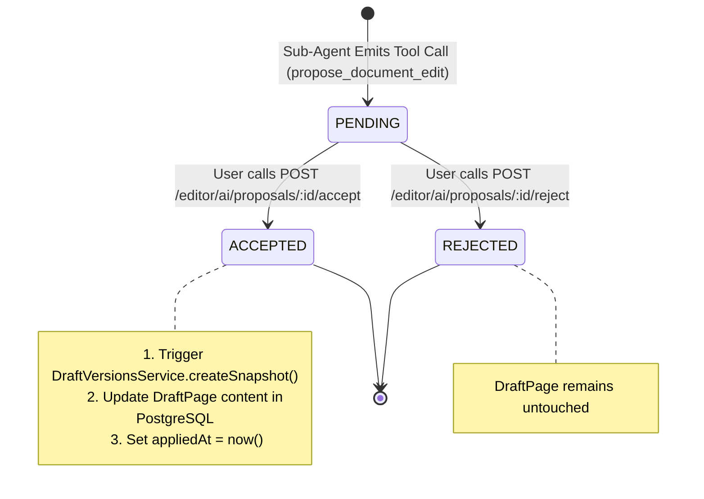
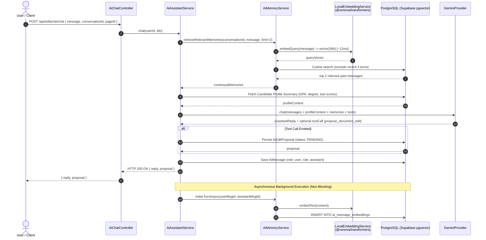

# Data Model: AI Assistant Architecture & Conversational Memory RAG

**Feature**: `011-ai-assistant-rag`  
**Date**: 2026-10-18  
**Status**: Completed  

---

## 1. Database Schema Additions (`prisma/schema.prisma`)

### A. Generator & Datasource Configuration

To enable `pgvector` in Prisma 6, the `postgresqlExtensions` preview feature and datasource extensions array must be configured:

```prisma
generator client {
  provider        = "prisma-client-js"
  previewFeatures = ["postgresqlExtensions"]
}

datasource db {
  provider   = "postgresql"
  url        = env("DATABASE_URL")
  directUrl  = env("DIRECT_URL")
  extensions = [vector]
}
```

---

### B. Enumerations

```prisma
enum AiEditProposalStatus {
  PENDING
  ACCEPTED
  REJECTED

  @@map("ai_edit_proposal_status")
}
```

---

### B. New Model: `AiMessageEmbedding`

Stores dense vector representations of conversational messages to support fast semantic retrieval (RAG) over past conversation turns.

```prisma
model AiMessageEmbedding {
  id             String   @id @default(dbgenerated("gen_random_uuid()")) @db.Uuid
  messageId      String   @unique @map("message_id") @db.Uuid
  conversationId String   @map("conversation_id") @db.Uuid
  userId         String   @map("user_id") @db.Uuid
  embedding      Unsupported("vector(384)")
  createdAt      DateTime @default(now()) @map("created_at")

  message      AiMessage       @relation(fields: [messageId], references: [id], onDelete: Cascade)
  conversation AiConversation  @relation(fields: [conversationId], references: [id], onDelete: Cascade)
  user         User            @relation(fields: [userId], references: [id], onDelete: Cascade)

  @@index([conversationId])
  @@index([userId])
  @@map("ai_message_embeddings")
}
```

#### SQL Vector Indexing (Supabase PostgreSQL):
```sql
CREATE EXTENSION IF NOT EXISTS vector;

CREATE INDEX IF NOT EXISTS idx_ai_message_embeddings_hnsw 
ON ai_message_embeddings USING hnsw (embedding vector_cosine_ops);
```

---

### C. New Model: `AiEditProposal`

Persists staged document modification proposals emitted by the sub-agent via tool calling. Tracks user acceptance and rollback snapshot lineage.

```prisma
model AiEditProposal {
  id             String                @id @default(dbgenerated("gen_random_uuid()")) @db.Uuid
  conversationId String?               @map("conversation_id") @db.Uuid
  pageId         String                @map("page_id") @db.Uuid
  userId         String                @map("user_id") @db.Uuid
  originalText   String                @map("original_text") @db.Text
  suggestedText  String                @map("suggested_text") @db.Text
  mode           String                @default("academic_tone") @map("mode")
  explanation    String?               @map("explanation") @db.Text
  status         AiEditProposalStatus  @default(PENDING) @map("status")
  appliedAt      DateTime?             @map("applied_at")
  createdAt      DateTime              @default(now()) @map("created_at")
  updatedAt      DateTime              @updatedAt @map("updated_at")

  conversation AiConversation? @relation(fields: [conversationId], references: [id], onDelete: SetNull)
  page         DraftPage       @relation(fields: [pageId], references: [id], onDelete: Cascade)
  user         User            @relation(fields: [userId], references: [id], onDelete: Cascade)

  @@index([userId])
  @@index([pageId])
  @@index([status])
  @@map("ai_edit_proposals")
}
```

---

## 2. Entity State Machine: `AiEditProposal`



---

## 3. Data Flow & Retrieval Sequence (Conversational RAG)


