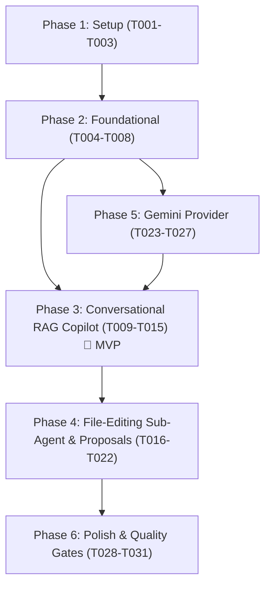

# Tasks: AI Assistant Architecture & Conversational Memory RAG

**Input**: Design documents from `/specs/011-ai-assistant-rag/`  
**Prerequisites**: `plan.md`, `spec.md`, `research.md`, `data-model.md`, `contracts/`, `quickstart.md`  

---

## Format: `[ID] [P?] [Story] Description with exact file path`

- **[P]**: Can run in parallel (different files, no blocking dependencies).
- **[Story]**: User story identifier (`[US1]`, `[US2]`, `[US3]`) mapping to `spec.md`.

---

## Phase 1: Setup (Shared Infrastructure)

**Purpose**: Dependency installation and environment preparation.

- [ ] T001 Install `@xenova/transformers` for in-process vector embeddings in package.json
- [ ] T002 [P] Configure Gemini environment variables (`GEMINI_API_KEY`, `GEMINI_MODEL`) in .env and .env.example
- [ ] T003 [P] Enable PostgreSQL vector extension and previewFeatures in prisma/schema.prisma

---

## Phase 2: Foundational (Blocking Prerequisites)

**Purpose**: Database schema expansion, migrations, and local embedding engine.

**⚠️ CRITICAL**: Must be completed before any user story can begin.

- [ ] T004 Add `AiMessageEmbedding`, `AiEditProposal`, and `AiEditProposalStatus` models to prisma/schema.prisma
- [ ] T005 Run Prisma migration to apply vector and proposal tables in prisma/migrations/
- [ ] T006 Create HNSW vector cosine distance index for `ai_message_embeddings` in Supabase PostgreSQL
- [ ] T007 Implement LocalEmbeddingService using `@xenova/transformers` in src/modules/ai-assistant/memory/local-embedding.service.ts
- [ ] T008 [P] Unit tests for LocalEmbeddingService in src/modules/ai-assistant/memory/local-embedding.service.spec.ts

**Checkpoint**: Vector storage, Prisma client, and local embedding engine verified and ready.

---

## Phase 3: User Story 1 - Conversational Writing Copilot with Long-Term Memory (Priority: P1) 🎯 MVP

**Goal**: Provide multi-turn conversational chat with long-term memory via local vector embeddings, Supabase `pgvector` semantic retrieval, and candidate profile credential injection.

**Independent Test**: An authenticated user shares personal credentials and achievements in early conversation turns, chats across multiple unrelated turns, and asks the assistant to draft an essay section. The assistant recalls and synthesizes the exact earlier facts.

- [ ] T009 [US1] Implement AiMemoryService for semantic retrieval and background vector indexing in src/modules/ai-assistant/memory/ai-memory.service.ts
- [ ] T010 [P] [US1] Unit tests for AiMemoryService in src/modules/ai-assistant/memory/ai-memory.service.spec.ts
- [ ] T011 [US1] Implement candidate profile context extraction in src/modules/ai-assistant/ai-assistant.service.ts
- [ ] T012 [US1] Integrate memory retrieval, profile grounding, and async background indexing into `AiAssistantService.chat` in src/modules/ai-assistant/ai-assistant.service.ts
- [ ] T013 [P] [US1] Unit tests for context assembly and memory recall in src/modules/ai-assistant/ai-assistant.service.spec.ts
- [ ] T014 [US1] Update AiChatController with unified response DTO in src/modules/ai-assistant/ai-chat/ai-chat.controller.ts
- [ ] T015 [P] [US1] Unit tests for AiChatController in src/modules/ai-assistant/ai-chat/ai-chat.controller.spec.ts

**Checkpoint**: User Story 1 fully functional. Conversational AI recalls past conversation turns with zero added latency.

---

## Phase 4: User Story 2 - Delegated File-Editing Sub-Agent with Staged Proposals (Priority: P2)

**Goal**: Enable the primary chat agent to delegate document modification requests to a stateless file-editing sub-agent, returning persistent, reviewable edit proposals with automatic rollback snapshots upon acceptance.

**Independent Test**: A user asks the chat assistant to rewrite a draft paragraph. The assistant outputs an edit proposal with status `PENDING`. The user calls the `/accept` endpoint, which verifies that an automatic draft snapshot is recorded and the draft page content updates.

- [ ] T016 [P] [US2] Create DTOs for edit proposals (`CreateProposalDto`, `ProposalActionDto`, `ProposalResponseDto`) in src/modules/ai-assistant/ai-proposals/dto/
- [ ] T017 [US2] Implement AiProposalsService managing proposal lifecycle (`PENDING`, `ACCEPTED`, `REJECTED`) in src/modules/ai-assistant/ai-proposals/ai-proposals.service.ts
- [ ] T018 [US2] Wire proposal acceptance to `DraftVersionsService.createSnapshot` and `DraftPagesService` in src/modules/ai-assistant/ai-proposals/ai-proposals.service.ts
- [ ] T019 [US2] Implement AiProposalsController for accept, reject, and list operations in src/modules/ai-assistant/ai-proposals/ai-proposals.controller.ts
- [ ] T020 [P] [US2] Unit tests for AiProposalsService and rollback snapshots in src/modules/ai-assistant/ai-proposals/ai-proposals.service.spec.ts
- [ ] T021 [P] [US2] Unit tests for AiProposalsController in src/modules/ai-assistant/ai-proposals/ai-proposals.controller.spec.ts
- [ ] T022 [US2] Connect tool-calling output from the primary agent to proposal persistence in src/modules/ai-assistant/ai-assistant.service.ts

**Checkpoint**: User Story 2 fully functional. Staged proposals allow safe document editing with one-click rollback.

---

## Phase 5: User Story 3 - Provider-Agnostic Model Routing with Google Gemini (Priority: P3)

**Goal**: Implement a native Google Gemini provider that communicates with Google's API, loads models dynamically from `.env` (`GEMINI_MODEL`, defaulting to `gemini-3.5-flash-lite`), supports function declarations for editing tools, and falls back gracefully.

**Independent Test**: Configure `GEMINI_API_KEY` and verify live requests route to Google Gemini. Unset the key and verify that deterministic mock fallbacks execute without 500 errors.

- [ ] T023 [US3] Implement GeminiProvider with Google Generative Language API (`v1beta`) in src/modules/ai-assistant/providers/gemini.provider.ts
- [ ] T024 [US3] Implement native tool declarations (`propose_document_edit`) in src/modules/ai-assistant/providers/gemini.provider.ts
- [ ] T025 [P] [US3] Unit tests for GeminiProvider in src/modules/ai-assistant/providers/gemini.provider.spec.ts
- [ ] T026 [US3] Register GeminiProvider as default primary provider in src/modules/ai-assistant/ai-assistant.module.ts
- [ ] T027 [US3] Update provider routing and fallback logic in src/modules/ai-assistant/ai-assistant.service.ts

**Checkpoint**: User Story 3 fully functional. Gemini provider handles text generation, chat, and tool calling with zero external SDK bloat.

---

## Phase 6: Polish & Cross-Cutting Concerns

**Purpose**: End-to-end integration, performance benchmarking, and quality gates.

- [ ] T028 [P] Update Swagger API annotations, DTO schemas, and sync Levora_API.postman_collection.json with new AI endpoints in src/modules/ai-assistant/
- [ ] T029 Execute end-to-end multi-turn memory recall and proposal validation from specs/011-ai-assistant-rag/quickstart.md
- [ ] T030 [P] Benchmark local vector embedding latency (<25ms) and Supabase vector cosine retrieval (<20ms)
- [ ] T031 Run repository quality gates (`pnpm lint`, `pnpm build`, `pnpm test`) verifying zero errors and 100% test pass rate

---

## Dependencies & Execution Order

---

## Parallel Execution Opportunities

- **Phase 1**: T002 (`.env` config) and T003 (`schema.prisma` vector flag) can run in parallel with T001.
- **Phase 2**: T008 (embedding tests) can run in parallel once T007 is implemented.
- **Phase 3 (US1)**: T010 (memory unit tests) and T015 (controller tests) can run in parallel with service integrations.
- **Phase 4 (US2)**: T016 (DTOs), T020 (proposal service tests), and T021 (proposal controller tests) can run in parallel.
- **Phase 5 (US3)**: T025 (Gemini provider unit tests) can run in parallel with module registration.
- **Phase 6**: T028 (Swagger docs) and T030 (Benchmarks) can execute concurrently.

---

## Implementation Strategy: MVP First

1. **Deliver MVP (US1 + US3)**: Implementing Foundational Phase + Gemini Provider + Conversational Memory RAG delivers immediate value: a fast, smart AI copilot that remembers candidate facts across working sessions for $0 embedding cost.
2. **Add Interactive Editing (US2)**: Once memory and Gemini are solid, wire the file-editing tool calling and staged proposal lifecycle for safe document editing.
3. **Verify & Polish (Phase 6)**: Run complete benchmark validation against the `quickstart.md` scenarios and pass all repository quality gates.
